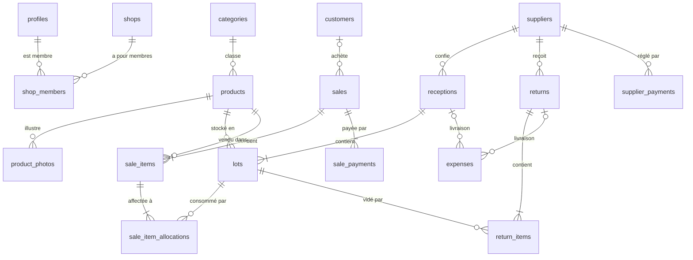

# Modèle de données — Jaay

Base : Supabase (Postgres). 18 tables, toutes rattachées à une boutique par `shop_id` et protégées par RLS. Les opérations qui touchent au stock ou à l'argent passent uniquement par des fonctions RPC transactionnelles.

Le lot est au centre : il relie ce qui entre (réceptions), ce qui sort (ventes et retours) et ce qui est dû (affectations au prix du lot).



Toutes les tables métier dépendent aussi de `shops` par `shop_id` (liens non dessinés).

---

## 1. Conventions

| Sujet | Règle |
| --- | --- |
| Nommage | Anglais, `snake_case`, tables au pluriel. |
| Identifiants | `id uuid primary key default gen_random_uuid()`. |
| Multi-boutiques | `shop_id uuid not null references public.shops(id) on delete cascade`, indexé. |
| Montants | `bigint` en FCFA entiers, `check (x >= 0)` sauf mention contraire. |
| Quantités | `integer`, `check (quantity > 0)` sur les lignes. |
| Dates | `timestamptz`, `created_at timestamptz not null default now()`. Dates métier (`sold_at`, `received_at`…) saisissables, `default now()`. |
| Audit | `created_by uuid references auth.users(id) default auth.uid()`. |
| Annulation | `status op_status not null default 'active'`, `cancelled_at`, `cancelled_by`, `cancel_reason`. Les calculs ignorent `cancelled`. |
| Archivage | Référentiels : `archived_at timestamptz` au lieu de supprimer. |

---

## 2. Types énumérés

```sql
create type public.shop_role        as enum ('owner', 'admin', 'manager');
create type public.op_status        as enum ('active', 'cancelled');
create type public.customer_type    as enum ('individual', 'reseller');
create type public.sale_channel     as enum ('whatsapp', 'instagram', 'facebook', 'tiktok', 'in_person', 'other');
create type public.payment_method   as enum ('wave', 'orange_money', 'cash', 'other');
create type public.expense_category as enum ('delivery', 'packaging', 'advertising', 'other');
```

---

## 3. Tables

### 3.1 Comptes et boutiques

```sql
create table public.profiles (
  id uuid primary key references auth.users(id) on delete cascade,
  full_name text not null,
  phone text,
  is_platform_admin boolean not null default false,
  created_at timestamptz not null default now()
);
-- Trigger on auth.users insert → insert profiles (full_name from raw_user_meta_data).

create table public.shops (
  id uuid primary key default gen_random_uuid(),
  name text not null,
  slug text not null unique check (slug ~ '^[a-z0-9]+(-[a-z0-9]+)*$'),
  logo_path text,
  currency text not null default 'XOF',
  whatsapp_phone text,
  show_public_prices boolean not null default true,
  catalog_enabled boolean not null default true,
  next_sale_number integer not null default 1,
  created_by uuid references auth.users(id) default auth.uid(),
  created_at timestamptz not null default now()
);

create table public.shop_members (
  shop_id uuid not null references public.shops(id) on delete cascade,
  user_id uuid not null references auth.users(id) on delete cascade,
  role public.shop_role not null,
  created_at timestamptz not null default now(),
  primary key (shop_id, user_id)
);
create index on public.shop_members (user_id);
```

### 3.2 Référentiels

```sql
create table public.suppliers (
  id uuid primary key default gen_random_uuid(),
  shop_id uuid not null references public.shops(id) on delete cascade,
  name text not null,
  phone text, address text, notes text,
  archived_at timestamptz,
  created_at timestamptz not null default now()
);

create table public.categories (
  id uuid primary key default gen_random_uuid(),
  shop_id uuid not null references public.shops(id) on delete cascade,
  name text not null,
  position integer not null default 0,
  unique (shop_id, name)
);
-- Créées par create_shop : 'Sacs à dos', 'Sacs à main', 'Sacs de voyage', 'Autres'.

create table public.products (
  id uuid primary key default gen_random_uuid(),
  shop_id uuid not null references public.shops(id) on delete cascade,
  category_id uuid references public.categories(id),
  name text not null,
  color text,
  description text,
  suggested_price bigint check (suggested_price >= 0),
  reseller_price bigint check (reseller_price >= 0),
  low_stock_threshold integer not null default 2,
  is_public boolean not null default true,
  archived_at timestamptz,
  created_at timestamptz not null default now()
);

create table public.product_photos (
  id uuid primary key default gen_random_uuid(),
  shop_id uuid not null references public.shops(id) on delete cascade,
  product_id uuid not null references public.products(id) on delete cascade,
  storage_path text not null,           -- '<shop_id>/<product_id>/<uuid>.webp'
  position integer not null default 0
);

create table public.customers (
  id uuid primary key default gen_random_uuid(),
  shop_id uuid not null references public.shops(id) on delete cascade,
  name text not null,
  phone text,
  type public.customer_type not null default 'individual',
  notes text,
  archived_at timestamptz,
  created_at timestamptz not null default now()
);
create index on public.customers (shop_id, phone);
```

### 3.3 Stock

```sql
create table public.receptions (
  id uuid primary key default gen_random_uuid(),
  shop_id uuid not null references public.shops(id) on delete cascade,
  supplier_id uuid not null references public.suppliers(id),
  received_at timestamptz not null default now(),
  note text,
  status public.op_status not null default 'active',
  cancelled_at timestamptz, cancelled_by uuid references auth.users(id), cancel_reason text,
  created_by uuid references auth.users(id) default auth.uid(),
  created_at timestamptz not null default now()
);

create table public.lots (
  id uuid primary key default gen_random_uuid(),
  shop_id uuid not null references public.shops(id) on delete cascade,
  reception_id uuid not null references public.receptions(id),
  product_id uuid not null references public.products(id),
  supplier_id uuid not null references public.suppliers(id),   -- copié de la réception
  received_at timestamptz not null,                            -- copié de la réception (tri FIFO)
  qty_received integer not null check (qty_received > 0),
  qty_sold integer not null default 0 check (qty_sold >= 0),
  qty_returned integer not null default 0 check (qty_returned >= 0),
  unit_cost bigint not null check (unit_cost >= 0),
  qty_available integer generated always as (qty_received - qty_sold - qty_returned) stored,
  created_at timestamptz not null default now(),
  check (qty_received - qty_sold - qty_returned >= 0)
);
create index lots_fifo_idx on public.lots (shop_id, product_id, received_at, id) where qty_received - qty_sold - qty_returned > 0;
```

Les lots d'une réception annulée sont exclus via la jointure sur `receptions.status`. Une réception ne s'annule que si `qty_sold = 0 and qty_returned = 0` pour tous ses lots.

### 3.4 Ventes

```sql
create table public.sales (
  id uuid primary key default gen_random_uuid(),
  shop_id uuid not null references public.shops(id) on delete cascade,
  number integer not null,                                  -- séquentiel par boutique
  customer_id uuid references public.customers(id),
  customer_type public.customer_type not null default 'individual',
  channel public.sale_channel not null default 'in_person',
  sold_at timestamptz not null default now(),
  total_amount bigint not null check (total_amount >= 0),
  amount_paid bigint not null check (amount_paid >= 0),
  note text,
  status public.op_status not null default 'active',
  cancelled_at timestamptz, cancelled_by uuid references auth.users(id), cancel_reason text,
  created_by uuid references auth.users(id) default auth.uid(),
  created_at timestamptz not null default now(),
  unique (shop_id, number),
  constraint sales_fully_paid check (amount_paid = total_amount)   -- MVP : pas de crédit client
);
create index on public.sales (shop_id, sold_at desc);

create table public.sale_items (
  id uuid primary key default gen_random_uuid(),
  shop_id uuid not null references public.shops(id) on delete cascade,
  sale_id uuid not null references public.sales(id) on delete cascade,
  product_id uuid not null references public.products(id),
  quantity integer not null check (quantity > 0),
  unit_price bigint not null check (unit_price >= 0),
  line_total bigint generated always as (quantity * unit_price) stored
);

create table public.sale_item_allocations (
  id uuid primary key default gen_random_uuid(),
  shop_id uuid not null references public.shops(id) on delete cascade,
  sale_item_id uuid not null references public.sale_items(id) on delete cascade,
  lot_id uuid not null references public.lots(id),
  supplier_id uuid not null references public.suppliers(id),
  quantity integer not null check (quantity > 0),
  unit_cost bigint not null check (unit_cost >= 0)          -- figé au moment de la vente
);

create table public.sale_payments (
  id uuid primary key default gen_random_uuid(),
  shop_id uuid not null references public.shops(id) on delete cascade,
  sale_id uuid not null references public.sales(id) on delete cascade,
  method public.payment_method not null,
  amount bigint not null check (amount > 0),
  paid_at timestamptz not null default now(),
  created_by uuid references auth.users(id) default auth.uid(),
  created_at timestamptz not null default now()
);
```

### 3.5 Retours, règlements, dépenses

```sql
create table public.returns (
  id uuid primary key default gen_random_uuid(),
  shop_id uuid not null references public.shops(id) on delete cascade,
  supplier_id uuid not null references public.suppliers(id),
  returned_at timestamptz not null default now(),
  note text,
  status public.op_status not null default 'active',
  cancelled_at timestamptz, cancelled_by uuid references auth.users(id), cancel_reason text,
  created_by uuid references auth.users(id) default auth.uid(),
  created_at timestamptz not null default now()
);

create table public.return_items (
  id uuid primary key default gen_random_uuid(),
  shop_id uuid not null references public.shops(id) on delete cascade,
  return_id uuid not null references public.returns(id) on delete cascade,
  lot_id uuid not null references public.lots(id),
  product_id uuid not null references public.products(id),
  quantity integer not null check (quantity > 0)
);

create table public.supplier_payments (
  id uuid primary key default gen_random_uuid(),
  shop_id uuid not null references public.shops(id) on delete cascade,
  supplier_id uuid not null references public.suppliers(id),
  amount bigint not null check (amount > 0),
  method public.payment_method not null,
  paid_at timestamptz not null default now(),
  note text,
  status public.op_status not null default 'active',
  cancelled_at timestamptz, cancelled_by uuid references auth.users(id), cancel_reason text,
  created_by uuid references auth.users(id) default auth.uid(),
  created_at timestamptz not null default now()
);

create table public.expenses (
  id uuid primary key default gen_random_uuid(),
  shop_id uuid not null references public.shops(id) on delete cascade,
  category public.expense_category not null default 'delivery',
  amount bigint not null check (amount > 0),
  spent_at timestamptz not null default now(),
  supplier_id uuid references public.suppliers(id),
  reception_id uuid references public.receptions(id),
  return_id uuid references public.returns(id),
  note text,
  status public.op_status not null default 'active',
  cancelled_at timestamptz, cancelled_by uuid references auth.users(id), cancel_reason text,
  created_by uuid references auth.users(id) default auth.uid(),
  created_at timestamptz not null default now()
);
```

---

## 4. Fonctions d'aide (sécurité)

```sql
create function public.is_shop_member(p_shop_id uuid) returns boolean
language sql stable security definer set search_path = '' as $$
  select exists (select 1 from public.shop_members
                 where shop_id = p_shop_id and user_id = auth.uid());
$$;

create function public.has_shop_role(p_shop_id uuid, p_roles public.shop_role[]) returns boolean
language sql stable security definer set search_path = '' as $$
  select exists (select 1 from public.shop_members
                 where shop_id = p_shop_id and user_id = auth.uid() and role = any (p_roles));
$$;
```

Raccourcis dans le code SQL : `has_shop_role(x, '{owner,admin}')` (= « finance »), `is_shop_member(x)` (= « tous »).

---

## 5. RLS

RLS activé sur **toutes** les tables. Aucune politique `insert/update/delete` sur les tables d'opérations : seules les RPC écrivent.

| Table | select | insert / update | delete |
| --- | --- | --- | --- |
| `profiles` | soi-même, ou membres d'une boutique commune | soi-même (update) | — |
| `shops` | membres | owner, admin (update) | — |
| `shop_members` | membres de la boutique | owner, admin (via Server Action) | owner, admin (pas le owner) |
| `suppliers`, `categories`, `products`, `product_photos` | membres | owner, admin | — (archivage) |
| `customers` | membres | membres | — (archivage) |
| `receptions`, `returns`, `expenses` | membres | RPC uniquement (expenses : membres en insert direct, update réservé owner/admin) | — |
| `lots`, `sale_item_allocations`, `supplier_payments` | owner, admin | RPC uniquement | — |
| `sales`, `sale_items`, `sale_payments` | owner, admin : tout ; manager : `created_by = auth.uid()` (via `sales`) | RPC uniquement | — |

Le gérant lit le stock via la fonction `get_stock`, jamais via `lots`.

**Storage** : bucket `product-photos` public en lecture ; écriture si `is_shop_member((storage.foldername(name))[1]::uuid)` et rôle owner/admin. Bucket `shop-logos` idem.

---

## 6. Fonctions RPC

Toutes : `security definer`, `set search_path = ''`, vérification du rôle en premier, `raise exception` avec un code lisible (`'INSUFFICIENT_STOCK'`, `'FORBIDDEN'`, `'PAYMENT_MISMATCH'`…) que le front traduit via `src/messages/fr.ts`.

### Écriture

| Fonction | Rôle | Effet |
| --- | --- | --- |
| `create_shop(p_name text, p_slug text, p_whatsapp_phone text) returns shops` | connecté | Crée la boutique, le membre `owner`, les catégories par défaut. |
| `create_reception(p_shop_id, p_supplier_id, p_received_at, p_items jsonb, p_delivery_fee bigint, p_note text) returns uuid` | tous | `p_items = [{product_id, quantity, unit_cost}]`. Crée la réception, un lot par ligne, la dépense de livraison si `> 0`. |
| `cancel_reception(p_reception_id, p_reason)` | owner, admin | Refusé si un lot a été vendu ou retourné. Annule aussi la dépense liée. |
| `create_sale(p_shop_id, p_customer_id, p_customer_type, p_channel, p_sold_at, p_items jsonb, p_payments jsonb, p_note) returns sales` | tous | Voir algorithme ci-dessous. |
| `cancel_sale(p_sale_id, p_reason)` | owner, admin | Restitue les quantités aux lots d'origine (`qty_sold -= allocation.quantity`). |
| `create_return(p_shop_id, p_supplier_id, p_returned_at, p_items jsonb, p_delivery_fee, p_note) returns uuid` | tous | `p_items = [{product_id, quantity}]`. FIFO sur les lots **de ce fournisseur**, `qty_returned += q`. |
| `cancel_return(p_return_id, p_reason)` | owner, admin | Restitue `qty_returned`. |
| `create_supplier_payment(p_shop_id, p_supplier_id, p_amount, p_method, p_paid_at, p_note)` | owner, admin | Règlement. |
| `cancel_supplier_payment(p_payment_id, p_reason)` | owner, admin | |

**Algorithme `create_sale`** (une seule transaction) :

1. Vérifier `is_shop_member(p_shop_id)`.
2. Valider : au moins une ligne ; Σ `p_payments.amount` = Σ `quantity × unit_price` (sinon `PAYMENT_MISMATCH`).
3. `update shops set next_sale_number = next_sale_number + 1 where id = p_shop_id returning next_sale_number - 1` → numéro de vente.
4. Insérer `sales`.
5. Pour chaque ligne `{product_id, quantity, unit_price}` :
    - insérer `sale_items` ;
    - `select … from lots join receptions … where lots.shop_id = p_shop_id and product_id = … and receptions.status = 'active' and qty_available > 0 order by received_at, id for update` ;
    - parcourir les lots, prendre `min(reste, qty_available)` sur chacun, insérer `sale_item_allocations (lot_id, supplier_id, quantity, unit_cost = lot.unit_cost)`, `update lots set qty_sold = qty_sold + pris` ;
    - si le reste > 0 après tous les lots → `raise exception 'INSUFFICIENT_STOCK'` (tout est annulé).
6. Insérer `sale_payments`.
7. Retourner la vente.

### Lecture

| Fonction | Rôle | Retour |
| --- | --- | --- |
| `get_stock(p_shop_id)` | tous | Par modèle : `product_id`, `qty_available`, `is_low` (≤ seuil). Aucun coût. |
| `get_supplier_balances(p_shop_id)` | owner, admin | Par fournisseur : dû (Σ allocations des ventes actives × `unit_cost`), réglé, solde, sacs en dépôt. |
| `get_supplier_lots(p_supplier_id)` | owner, admin | Lots avec quantités et coûts. |
| `get_dashboard(p_shop_id, p_from, p_to)` | tous | JSON : CA, nb sacs, nb ventes, répartition canal/paiement, top modèles, stock bas ; **plus** marge, dépenses, bénéfice net, soldes fournisseurs **si owner/admin**. Pour un manager, limité à ses propres ventes. |
| `get_customer_stats(p_shop_id)` | tous | Par client : nb achats, total dépensé, dernier achat. |
| `get_public_catalog(p_slug text)` | `anon` | Boutique (nom, logo, WhatsApp) + modèles `is_public`, non archivés, `qty_available > 0`, photos, prix seulement si `show_public_prices`. `grant execute … to anon`. |

**Exemple FIFO à reproduire en test** : lot A = 10 sacs à 5 000 F reçus le 1er septembre ; lot B = 10 sacs à 5 500 F reçus le 20 septembre. Vente de 12 sacs à 8 000 F → A : 10 × 5 000 = 50 000 F ; B : 2 × 5 500 = 11 000 F. Coût 61 000 F, CA 96 000 F, marge 35 000 F, solde fournisseur +61 000 F, reste 8 sacs dans B. Annulation → A et B reviennent à 10 disponibles chacun, solde 0.

---

## 7. Tests pgTAP obligatoires (`supabase/tests/`)

1. Isolation : un membre de la boutique X ne lit aucune ligne de la boutique Y (toutes tables).
2. Un `manager` ne lit pas `lots`, `sale_item_allocations`, `supplier_payments` ; `get_supplier_balances` lève `FORBIDDEN`.
3. Un `manager` ne lit que ses propres ventes.
4. `create_sale` : exemple FIFO ci-dessus (affectations, coûts, compteurs).
5. `create_sale` : stock insuffisant → exception, aucune ligne créée.
6. `create_sale` : paiements ≠ total → exception.
7. `cancel_sale` : compteurs restaurés, solde recalculé.
8. `create_return` : ne touche que les lots du fournisseur choisi ; retour > stock → exception.
9. `cancel_reception` refusé si un lot a été vendu.
10. Écriture directe dans `sales` ou `lots` depuis un client authentifié → refusée.
11. `get_public_catalog` : n'expose ni coût ni prix si `show_public_prices = false`.

---

## 8. Évolutivité

| Évolution | Ce qui change |
| --- | --- |
| Crédit client | Supprimer la contrainte `sales_fully_paid`, ajouter `payment_status` (`paid`, `partial`, `unpaid`) et une vue des restes à payer. `sale_payments` existe déjà. |
| Plusieurs points de vente | Table `locations`, colonne `location_id` sur `lots`, `sales`, `returns`. |
| Achat ferme | `acquisition_type` (`consignment`, `purchase`) sur `receptions` : un lot acheté est dû à la réception. |
| Abonnements SaaS | Tables `plans`, `subscriptions` liées à `shops`. |
| Paiement en ligne | `sale_payments.provider_ref`. |
